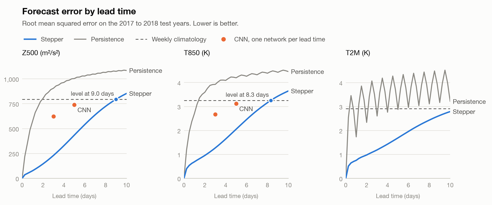
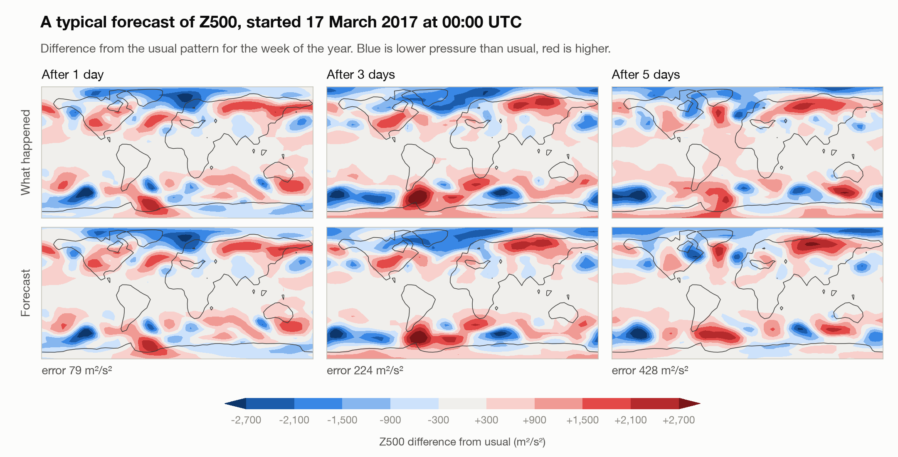

# Weather Forecaster

A neural network that forecasts global weather, scored on the WeatherBench benchmark.

## How It Works

The model learns from ERA5, a reconstruction of the global atmosphere every 6 hours since 1959. This project uses it on a 64 x 32 grid, where each cell is 5.625 degrees wide. Given the state of the atmosphere now, the network predicts the state 3 or 5 days later. It trains on 1979 to 2015, uses 2016 to decide when to stop training, and is scored on 2017 and 2018, which it never sees.

Scores are root mean squared error on three fields WeatherBench tracks: geopotential at 500 hPa (Z500, the mid-level pressure pattern that steers weather systems), temperature at 850 hPa (T850, about 1.5 km up) and temperature 2 m above the ground (T2M). Grid cells near the poles cover less area than cells at the equator, so every error is weighted by the cosine of its latitude.

A forecast score only means something next to baselines that use no model at all. Persistence says the weather stays as it is now. Climatology says it will be the long-term average. Weekly climatology uses the average for that week of the year.

The first network is the CNN from the WeatherBench paper: five 5x5 convolutions, 64 channels wide, 313,858 parameters. Longitude wraps around the globe, so each convolution pads the east edge of the map with the west edge instead of zeros.

The second model, the stepper, does not jump straight to a lead time. It predicts how the atmosphere changes over 6 hours, and feeding its output back in gives a forecast for any lead time from one network: 12 steps for 3 days, 40 steps for 10 days. It reads 23 fields instead of 2: geopotential, temperature and both wind components at four heights, humidity at three, and the temperature, wind and pressure at the surface. It is also told the time of day, the season, where the land is and how high the terrain is, none of which can be read off the weather itself. The network is a residual network with 8 blocks, 128 channels wide, 2,428,055 parameters. Its last layer starts at zero, so before training it predicts no change, which is the persistence forecast.

A network trained only on single steps falls apart when it is fed its own output, because it has never seen its own mistakes as input. So the stepper trains on single steps first and then on rollouts of 2, 4 and 8 steps. In a rollout every step is compared with what really happened, and the error at the last step is passed back through all the steps before it.

## Results

Baselines on the 2017 to 2018 test years, next to the numbers published in the WeatherBench paper (Rasp et al. 2020, Table 2). Lower is better.

| Field | Baseline | This repo | Published | Difference |
|---|---|---|---|---|
| Z500 (m^2/s^2) | persistence 3d | 906 | 936 | -3.2% |
| Z500 (m^2/s^2) | persistence 5d | 1003 | 1033 | -2.9% |
| Z500 (m^2/s^2) | climatology | 1058 | 1075 | -1.6% |
| Z500 (m^2/s^2) | weekly climatology | 795 | 816 | -2.6% |
| T850 (K) | persistence 3d | 3.92 | 4.23 | -7.2% |
| T850 (K) | persistence 5d | 4.20 | 4.56 | -7.9% |
| T850 (K) | climatology | 5.35 | 5.51 | -2.9% |
| T850 (K) | weekly climatology | 3.26 | 3.50 | -7.0% |
| T2M (K) | persistence 3d | 2.60 | 3.00 | -13.2% |
| T2M (K) | persistence 5d | 2.88 | 3.27 | -12.0% |
| T2M (K) | climatology | 5.89 | 6.07 | -3.0% |
| T2M (K) | weekly climatology | 2.91 | 3.19 | -8.8% |

The baselines here come out lower than the published ones, by 2 to 3 percent for Z500 and more for temperature. The likely reason is the data version. This repo uses the WeatherBench 2 copy of ERA5, which averages each coarse cell from the fine grid. The original benchmark interpolated instead, which keeps more small-scale detail and so gives larger errors. The gap is biggest for T2M, the field with the most small-scale detail, which fits that explanation. It is not confirmed yet, see Limitations.

The first network on the same test years, next to the CNN in the WeatherBench paper and weekly climatology, the strongest baseline above. Each lead time is its own trained network.

| Field | Lead time | This repo | Published CNN | Weekly climatology |
|---|---|---|---|---|
| Z500 (m^2/s^2) | 3 days | 623 | 626 | 795 |
| Z500 (m^2/s^2) | 5 days | 740 | 757 | 795 |
| T850 (K) | 3 days | 2.67 | 2.87 | 3.26 |
| T850 (K) | 5 days | 3.12 | 3.37 | 3.26 |

The network beats every no-model baseline at both lead times. Against weekly climatology its Z500 error is 22 percent lower at 3 days and 7 percent lower at 5 days. The lead shrinks because the atmosphere gets harder to predict the further ahead you look, while climatology is equally good at any lead time.

It also lands within a few percent of the published CNN. That is a match, not an improvement. The baselines on this data version already score 2 to 8 percent lower than the published ones, and the gaps here are no larger.

Each network trained for 30 epochs on a free Colab T4 GPU, about 37 minutes per network.

The stepper on the same test years. One trained network gives every lead time. Weekly climatology is the same at all of them.

| Field | 1 day | 3 days | 5 days | 7 days | 10 days | Weekly climatology |
|---|---|---|---|---|---|---|
| Z500 (m^2/s^2) | 77 | 230 | 435 | 639 | 853 | 795 |
| T850 (K) | 0.69 | 1.27 | 2.05 | 2.83 | 3.65 | 3.26 |
| T2M (K) | 0.75 | 1.19 | 1.69 | 2.21 | 2.79 | 2.91 |

The stepper cuts the first network's Z500 error by 63 percent at 3 days and 41 percent at 5 days, and its T850 error by 52 and 34 percent. It stays ahead of weekly climatology for more than 8 days on Z500 and T850 and for all 10 days on T2M.



The same scores at every lead time. Each curve starts at zero because a forecast starts from the true state. The dots mark where the stepper's error reaches weekly climatology: day 9.0 on Z500 and day 8.3 on T850. Persistence zigzags on temperature because a forecast 12 hours ahead compares day with night.



One forecast next to what really happened. The maps show how far Z500 is from its usual pattern for the week of the year, which is where the highs and lows are. The start date was not chosen by eye. Forecasts were started every 3 days through 2017 and 2018, 242 in all, and this is the one with the median 5-day error, so it is a typical forecast. After 1 day the forecast is hard to tell from the truth. After 5 days the large features are still in the right places, but their strength and exact position have drifted.

The WeatherBench paper also scores physical forecast models, which solve the equations of the atmosphere instead of learning from data. IFS is the model of the European weather centre. T42 and T63 are that model run on coarse grids, and operational IFS is its full-resolution forecast.

| Field | Lead time | Stepper | IFS T42 | IFS T63 | Operational IFS |
|---|---|---|---|---|---|
| Z500 (m^2/s^2) | 3 days | 230 | 489 | 268 | 154 |
| Z500 (m^2/s^2) | 5 days | 435 | 743 | 463 | 334 |
| T850 (K) | 3 days | 1.27 | 3.09 | 1.85 | 1.36 |
| T850 (K) | 5 days | 2.05 | 3.83 | 2.52 | 2.03 |

The IFS columns are published scores on the original benchmark data, so small gaps mean nothing. Baselines in this repo score about 3 percent lower than published for Z500 and 7 to 8 percent lower for T850. Allowing for that, the stepper is clearly ahead of IFS T42 everywhere, and ahead of IFS T63 on T850 and on Z500 at 3 days, where its error is 14 percent lower. At 5 days its Z500 error is 6 percent lower than IFS T63, which is too close to that margin to call. The operational IFS is well ahead on Z500. On T850 the two look level, but the difference is inside the margin, so the stepper is likely still behind.

The rollout epochs kept improving the forecast after single-step training had levelled off. On the 2016 validation year the 3-day Z500 error stayed between 302 and 314 over the last five single-step epochs, then fell to 230 over the 16 rollout epochs. A run without rollouts is needed to say how much of that is the rollouts and how much is the extra training.

The stepper trained for 32 epochs on a free Kaggle T4 GPU in 2 hours 34 minutes.

## Limitations

- Scores are not exactly comparable to the published WeatherBench table until the data-version explanation above is checked against the original benchmark files.
- The grid is coarse. One cell is about 600 km wide at the equator, so the model cannot see storms, fronts or anything local.
- The first network only sees Z500 and T850 and predicts one fixed lead time per trained model.
- The stepper's scores come from one training run with one random seed. Its validation score was still improving in the last epoch, so a longer run might score better.
- How much rollout training adds is not measured yet. That needs a run without it.
- Both CNNs ran to the 30-epoch limit with the validation loss still falling slowly, so a longer run might score a little better.
- Training on a laptop GPU is slow, about 2 minutes per epoch for the small CNN.

## Files

- `src/weather_forecaster/era5.py` downloads ERA5 channels from the public WeatherBench 2 bucket and reads them back as memory-mapped arrays
- `src/weather_forecaster/metrics.py` latitude-weighted RMSE and anomaly correlation
- `src/weather_forecaster/baselines.py` persistence and climatology forecasts
- `src/weather_forecaster/dataset.py` stacks channels and normalizes them for training
- `src/weather_forecaster/models.py` the CNN and the residual network
- `src/weather_forecaster/train.py` training loop and scoring for the CNN
- `src/weather_forecaster/features.py` the stepper's extra inputs: time of day, season, land and terrain
- `src/weather_forecaster/stepper.py` the 6-hour step, rollouts and scoring at every lead time
- `src/weather_forecaster/train_stepper.py` rollout training for the stepper
- `src/weather_forecaster/forecast.py` runs single forecasts from a trained stepper
- `src/weather_forecaster/plots.py` the charts and maps
- `scripts/` command-line entry points for downloading, baselines, training and charts
- `notebooks/colab_train.ipynb` trains the CNN on a free Google Colab GPU
- `notebooks/kaggle_train.ipynb` trains the stepper on a free Kaggle GPU
- `tests/` unit tests for the downloader, metrics, baselines, normalization, models, stepper, both training loops, single forecasts and the charts
- `results/` scores written by the scripts
- `figures/` charts and maps drawn from the scores and the trained stepper

## Tech Stack

- Python, PyTorch
- NumPy, Zarr, gcsfs
- Matplotlib
- pytest, ruff

## How to Run

```
python3 -m venv venv
source venv/bin/activate
pip install -e . pytest

python scripts/download.py --preset baselines   # about 1.5 GB into data/
python scripts/baselines.py
python scripts/train.py --lead-days 3
pytest
```

Training saves its progress after every epoch, so running the same command again continues an interrupted run from the last completed epoch.

To train on a free GPU instead of your own machine, open `notebooks/colab_train.ipynb` in Google Colab and choose Runtime > Run all.

The stepper needs more data and hours of GPU time:

```
python scripts/download.py --preset forecast --out data/era5_forecast   # about 12 GB
python scripts/train_stepper.py
```

To train it on a free Kaggle GPU, import `notebooks/kaggle_train.ipynb` into Kaggle, set the accelerator to GPU T4 x2, turn the internet on, and choose Save Version > Save & Run All. The run continues with the tab closed.

To redraw the charts from the scores in `results/`:

```
python scripts/plot_results.py
```

The forecast maps need the trained stepper and the test years of its 23 fields, about 0.5 GB:

```
python scripts/download.py --preset forecast --start 2017-01-01T00 --end 2018-12-31T18 --out data/era5_forecast_test
python scripts/plot_forecast.py --model runs/stepper/model.pt
```
